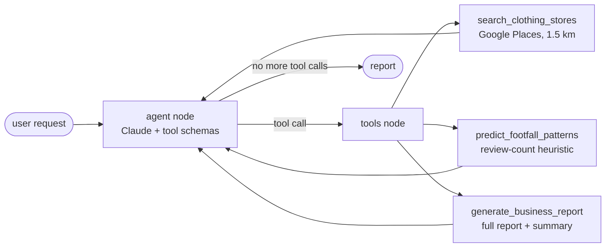

# LangGraph Competitive-Intelligence Agent

**A Claude-powered LangGraph agent that finds the clothing stores near a location with the Google Places API, groups them into leaders and direct competitors, estimates when they're busy, and writes a business report with an executive summary.**

[](https://colab.research.google.com/github/dojedaro/langgraph-competitive-intelligence-agent/blob/main/notebook/LangGraph_Pipeline.ipynb)
[](https://github.com/dojedaro/langgraph-competitive-intelligence-agent/actions/workflows/notebooks.yml)

## How it works



A LangGraph `StateGraph` with two nodes: the **agent** (Claude with the three tools bound) and a
**tools** node that executes whatever the agent called. A conditional edge loops back to the agent
until it stops calling tools. The graph state carries the message history plus the target location
and search radius.

| Tool | What it does |
|---|---|
| `search_clothing_stores` | Google Places (New) nearby search: name, rating, review count, address |
| `predict_footfall_patterns` | Weekday and weekend hourly traffic curves, scaled by a popularity factor of `review_count / 100`, clamped to 0.5–1.5 |
| `generate_business_report` | Market leaders vs. direct and indirect competitors, peak hours, staffing and opening-hour suggestions |

## Example output

From the saved run (Seoul, 1.5 km radius): the agent ranked stores by rating and review count and
named **UNIQLO Gwanghwamun D-Tower** (rating 4.0, 331 reviews) as a market leader, then produced the
full report and an executive summary.

## Honest notes

- **The footfall numbers are a heuristic, not data.** Traffic curves are a fixed daily shape scaled
  by review count. Google Places doesn't expose real visit counts in this API.
- **Report percentages are model-written.** Lines such as "optimized staffing could improve
  efficiency by 25–30%" come from the LLM, not from any calculation. A production version should
  only print numbers the tools computed.
- **The saved run searched the wrong neighbourhood.** The "Gangnam" coordinates were Seoul City Hall,
  about 9 km north, which is why a Gwanghwamun store appears. This is fixed in the code (Gangnam
  Station); the outputs in the notebook are from the earlier run.
- **No evaluation.** There's no check that the report's claims match the tool data.

## Run it

```bash
pip install -r requirements.txt
jupyter notebook notebook/LangGraph_Pipeline.ipynb
```

You need an `ANTHROPIC_API_KEY` and a Google Maps API key with the Places API (New) enabled; the
notebook asks for both with `getpass`. The notebook pins `claude-3-sonnet-20240229` and `claude-3-5-sonnet-20241022`, which
Anthropic has retired: change both to a current Claude model before running.

## Stack

Python, LangGraph, LangChain (Anthropic integration), Claude, Google Places API (New).

## Next steps

- A grounding check: every number in the report must come from a tool result, or be removed.
- Real foot-traffic data (for example Seoul's open commercial-district data) instead of the heuristic.
- Cache Places results so reruns don't spend API quota.

## License

MIT
